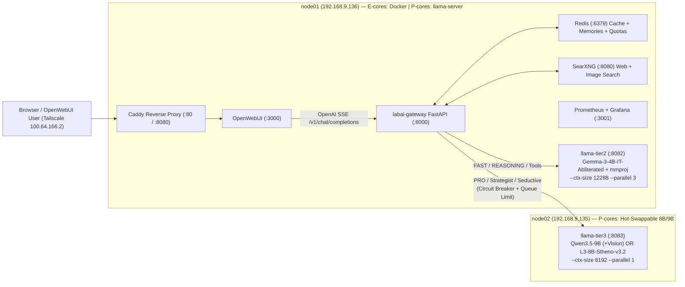
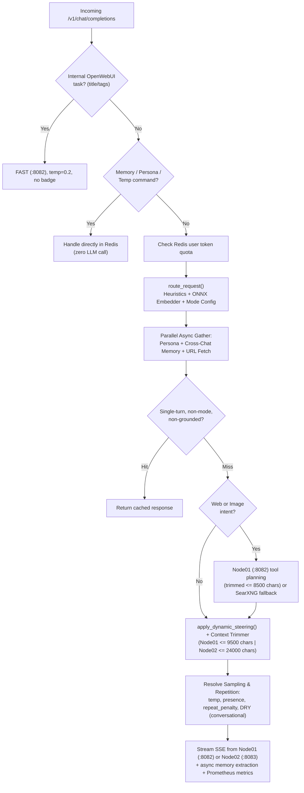

# LabAI: Production Multi-Node CPU AI Platform

A hardware-aware, uncensored, self-hosted AI platform running **24/7 on two CPU-only desktops** (`2× Intel Core i7-12700`, `~14 GiB` usable RAM each).

Instead of wrapping a single model in a basic UI, **LabAI** implements a custom FastAPI **AI Control Plane** (`labai-gateway`) with:
- **Dual-Node Asymmetric Serving**:
  - **`node01` (`:8082`)**: Solo `Gemma-3-4B-IT-Abliterated` (`Q4_K_M` + `mmproj-Q8_0` Vision, `--ctx-size 12288 --parallel 3`) for fast daily chat, vision, web-search tool calling, and Grok banter modes.
  - **`node02` (`:8083`)**: Hot-swappable 8B/9B slot via `scripts/swap_node02_stheno.sh`:
    - **`qwen`**: `Huihui-Qwen3.5-9B-Abliterated` (`Q4_K_M` + Vision) for max coding/reasoning IQ (`labai-pro`, `labai-strategist`).
    - **`stheno`**: `L3-8B-Stheno-v3.2` (`Q4_K_M`) for purpose-built AI-GF / uncensored RP (`labai-seductive`).
- **9 Selectable Models & Grok Modes**: `labai-auto`, `labai-fast`, `labai-reasoning`, `labai-pro`, `labai-seductive`, `labai-unhinged`, `labai-conspiracy`, `labai-therapist`, and `labai-strategist`.
- **3-Stage Auto Router + Dynamic Budgeting**: Heuristics + local ONNX semantic classifier (`BAAI/bge-small-en-v1.5`) + circuit-breaker failover, scaling budgets (`768` / `2048` / `4096` tokens, `220` cap for punchy banter).
- **RP & Tokenizer-Safe Sampling**: Per-mode `temperature`, `presence_penalty`, `repeat_penalty`, `repeat_last_n=128`, and `llama.cpp` **DRY** (`dry_multiplier=0.8`) to eliminate phrase loops without SentencePiece token merges.
- **Live Web Search, Image Lookup & Cross-Chat Memory**: Self-hosted SearXNG + Redis semantic memory, persona storage, and response caching.
- **Asymmetric CPU Core Isolation**: P-cores (`0,2,4,6,8,10,12,14`) pinned to bare-metal `llama-server`; E-cores (`16-19`) pinned to Docker (OpenWebUI, Gateway, Redis, SearXNG, Caddy, Prometheus, Grafana).

---

## 1. System Architecture & Cluster Topology



---

## 2. End-to-End Request Pipeline



---

## 3. Models & Grok Modes Matrix (`PUBLIC_MODELS` & `MODE_CONFIGS`)

Configured in [`gateway/app/router.py`](gateway/app/router.py):

| Model ID | Target Node / Backend | Temp | Presence | Repeat Penalty | DRY | Purpose |
|---|---|---|---|---|---|---|
| `labai-auto` | Dynamic (`:8082` daily / `:8083` complex or >10k ctx) | `0.3` / `0.55` / `0.78` | `0.0` / `0.05` / `0.12` | `1.04`–`1.05` | Conversational only | Smart default router for daily chat, search, coding, and escalation |
| `labai-fast` | `node01` (`Gemma-3-4B`) | Dynamic | Dynamic | `1.04`–`1.05` | Conversational only | Direct low-latency Node01 slot |
| `labai-reasoning` | `node01` (`Gemma-3-4B`) | Dynamic | Dynamic | `1.04`–`1.05` | Conversational only | Direct daily + vision Node01 slot |
| `labai-pro` | `node02` (`Qwen3.5-9B` / `PRO`) | `0.3` / `0.55` | `0.0` / `0.05` | `1.04`–`1.05` | Off (`is_conversational=False`) | High-IQ coding, architecture, vision (`PRO_SYSTEM_PROMPT`, zero GF bleed) |
| `labai-seductive` | `node02` (`PRO` — best on `Stheno-8B`) | `0.80` | `0.10` | `1.05` | On (`0.8`) | `Leila` persona: warm teasing buildup → explicit physical RP with spatial continuity |
| `labai-unhinged` | `node01` (`Gemma-3-4B`) | `0.82` | `0.12` | `1.05` | On (`0.8`) | Savage dark humor, fast roasts, zero filter |
| `labai-conspiracy` | `node01` (`Gemma-3-4B`) | `0.75` | `0.10` | `1.05` | On (`0.8`) | Cynical geopolitical/finance/tech rabbit-hole theorist |
| `labai-therapist` | `node01` (`Gemma-3-4B`) | `0.62` | `0.10` | `1.05` | On (`0.8`) | Warm, grounded late-night listener |
| `labai-strategist` | `node02` (`PRO`) | `0.45` | `0.05` | `1.05` | Off | Ruthless finance, career, and leverage strategist |

---

## 4. Evolution & Engineering Decisions ("Why We Did What, Where")

### A. Node01 RAM Crisis → Solo `Gemma-3-4B-IT-Abliterated`
- **Problem:** Running two `llama-server` models (`tier1` + `tier2`) alongside Docker on a `14.88 GiB` host pushed Node01 to `84 MiB` free RAM and maxed out `4 GB` swap.
- **Fix:** Created [`scripts/migrate_to_gemma3_single_node01.sh`](scripts/migrate_to_gemma3_single_node01.sh) and updated [`systemd/llama-tier2.service`](systemd/llama-tier2.service) to run a single `Gemma-3-4B-IT-Abliterated` (`Q4_K_M` + `mmproj-Q8_0`) on `:8082` with `--ctx-size 12288 --parallel 3` (4096 tokens/slot), freeing ~10 GiB RAM. Both `tier1_url` and `tier2_url` point to `:8082` in [`gateway/app/config.py`](gateway/app/config.py) and [`deploy/docker-compose.yml`](deploy/docker-compose.yml).

### B. SentencePiece Token Merges (`Iam`, `Iarch`, `oring`) → Sampler Re-tuning
- **Problem:** Gemma 3 uses a **SentencePiece** tokenizer. Stacking `repeat_penalty=1.12` + `frequency_penalty=0.15` + `presence_penalty=0.28` + `repeat_last_n=256` over-penalized high-frequency tokens like `"I"`, forcing merged tokens (`Iam`, `Iarch`, `oring`).
- **Fix:** In `resolve_repetition_params()` ([`gateway/app/router.py`](gateway/app/router.py)) and [`gateway/app/main.py`](gateway/app/main.py), set `frequency_penalty=0.0`, `repeat_penalty=1.04`–`1.05`, and `repeat_last_n=128` for conversational turns.

### C. Phrase Loops & Verbatim Prompt Copying → `llama.cpp` DRY Sampler
- **Problem:** Lowering `repeat_penalty` to stop token merges allowed multi-word phrase loops (`"Let me..."` triplets) in RP.
- **Fix:** Added **DRY (Don't Repeat Yourself)** parameters (`dry_multiplier=0.8`, `dry_base=1.75`, `dry_allowed_length=2`, `dry_penalty_last_n=512`) for conversational turns in [`gateway/app/main.py`](gateway/app/main.py). DRY penalizes repeating multi-word *sequences* instead of single tokens.

### D. `labai-pro` `400 Bad Request` on Large Code Pastes → Strict Context Trimming
- **Problem:** Pasting `router.py` (`28,476` chars ≈ `8,500+` tokens) caused HTTP `400 Bad Request` when hitting Node01 (`:8082`, 4096 tokens/slot) because:
  1. `trim_messages_for_ctx()` skipped truncation when the *single* latest message exceeded the whole budget (`kept_rev` was empty).
  2. `_run_tool_planning()` always sent the untrimmed message list to Node01 (`:8082`) even for `PRO` requests.
- **Fix:** Added `_truncate_message_content()` inside `trim_messages_for_ctx()` ([`gateway/app/router.py`](gateway/app/router.py)) guaranteeing `<= 9500` chars on Node01 and `<= 24000` chars on Node02, and trimmed `_run_tool_planning` inputs to `8500` chars in [`gateway/app/main.py`](gateway/app/main.py).

### E. `labai-pro` Girlfriend Persona Bleed → `PRO_SYSTEM_PROMPT` Isolation
- **Problem:** Saying `"hey"` on `labai-pro` matched `is_conversational=True` and injected `BASE_SYSTEM_PROMPT` (which contains flirt/RP instructions), causing `Qwen3.5-9B` to reply like a sassy girlfriend.
- **Fix:** Added `PRO_SYSTEM_PROMPT` and forced `is_conversational = False` when `requested_model == "labai-pro"` in [`gateway/app/router.py`](gateway/app/router.py).

### F. `labai-seductive` Physics & Pacing → Node02 + Hot-Swappable `L3-8B-Stheno-v3.2`
- **Problem:** General abliterated models—especially at 4B (`Gemma-3-4B`)—struggle with physical/spatial continuity across multi-turn RP (mixing up anatomy or jumping 0-to-100 on `"hey"`). Even `Qwen3.5-9B` occasionally wrote impossible body geometry.
- **Fix:** Routed `labai-seductive` to `ModelTier.PRO` (`node02:8083`) and added [`systemd/llama-tier3-stheno.service`](systemd/llama-tier3-stheno.service) + [`scripts/swap_node02_stheno.sh`](scripts/swap_node02_stheno.sh) to hot-swap `node02` between `L3-8B-Stheno-v3.2` (purpose-built RP model, ~4.9 GiB RAM) and `Qwen3.5-9B` (+Vision) in ~5 seconds without touching `node01` Docker services.

### G. Thinking Template Guard (`supports_thinking`)
- **Problem:** Sending `chat_template_kwargs: {"enable_thinking": ...}` indiscriminately isn't meant for Gemma 3 on Node01.
- **Fix:** Added `tier1_supports_thinking=False`, `tier2_supports_thinking=False`, `tier3_supports_thinking=True` in [`gateway/app/config.py`](gateway/app/config.py) and `supports_thinking()` checks in [`gateway/app/main.py`](gateway/app/main.py) and [`gateway/app/memory.py`](gateway/app/memory.py).

---

## 5. Complete Repository Map

```text
├── README.md                                  # This A-to-Z guide
├── docs/
│   ├── ARCHITECTURE.md                        # Hardware bottlenecks & design notes
│   ├── COMPLETE_GUIDE.md                      # Original operations guide
│   └── DEEP_DIVE_CONCEPTS.md                  # MLOps & quantization deep dive
├── gateway/
│   ├── Dockerfile
│   ├── pytest.ini
│   ├── requirements.txt
│   ├── app/
│   │   ├── main.py                            # FastAPI OpenAI SSE gateway, DRY/samplers, tool planning, metrics
│   │   ├── router.py                          # 3-stage router, Grok MODE_CONFIGS, PRO/BASE prompts, ctx trimmer
│   │   ├── config.py                          # LABAI_* Pydantic settings & thinking/concurrency flags
│   │   ├── backends.py                        # Node01 semaphore (3 slots) & Node02 circuit breaker (3 fails/30s)
│   │   ├── cache.py                           # Redis exact/semantic response cache & sliding user token quotas
│   │   ├── memory.py                          # Cross-chat semantic memory, persona, temp chat & chat commands
│   │   └── web_search.py                      # SearXNG web/image search, URL SSRF guard, HTML extraction
│   └── tests/
│       ├── test_frontier.py                   # 9 tests: web/image search, SSRF, memory commands, vision guard
│       └── test_router.py                     # 16 tests: routing, budgets, sampling, Grok modes, ctx trim, Pro isolation
├── deploy/
│   ├── docker-compose.yml                     # E-core pinned stack (Caddy, OpenWebUI, Gateway, Redis, SearXNG, Prom, Grafana)
│   ├── Caddyfile                              # Unbuffered SSE reverse proxy
│   ├── prometheus.yml                         # Scrapes gateway, node01/node02 llama-servers, node-exporter
│   ├── .env.example                           # Environment template
│   ├── grafana/provisioning/                  # Auto-provisioned Grafana dashboards & datasources
│   └── searxng/settings.yml                   # JSON API enabled for gateway search
├── systemd/
│   ├── llama-tier1.service                    # Legacy tier1 unit (disabled on node01)
│   ├── llama-tier1-vision.service             # Legacy tier1 vision unit
│   ├── llama-tier2.service                    # Active node01 (:8082) Gemma-3-4B-IT-Abliterated + mmproj
│   ├── llama-tier3.service                    # node02 (:8083) Huihui-Qwen3.5-9B-Abliterated + mmproj
│   └── llama-tier3-stheno.service             # node02 (:8083) L3-8B-Stheno-v3.2 (RP / AI-GF mode)
└── scripts/
    ├── setup_worker_ssh.sh                    # Passwordless SSH node01 -> node02
    ├── node_provision.sh                      # Native llama.cpp build + initial model setup
    ├── deploy_cluster.sh                      # Full 2-node cluster deploy
    ├── migrate_to_gemma3_single_node01.sh     # Solo Gemma-3-4B node01 migration + nuclear reset
    ├── migrate_to_qwen35_abliterated.sh       # Qwen3.5 abliterated migration script
    ├── swap_node02_stheno.sh                  # Reversible 1-command node02 hot-swap (stheno <-> qwen)
    └── upgrade_tier1_vision.sh                # Legacy tier1 vision upgrade
```

---

## 6. In-Chat Memory, Persona & Temporary Chat Commands

Handled directly by [`gateway/app/memory.py`](gateway/app/memory.py) with zero LLM overhead:

| Command | Effect |
|---|---|
| `memory` / `memory list` | List saved cross-chat memories for your account |
| `memory clear` / `forget everything` | Wipe all saved cross-chat memories for your account |
| `memory delete <n>` | Delete a specific memory by number |
| `memory off` / `memory on` | Pause or resume saving/recalling memories |
| `persona <instructions>` | Set persistent style/preferences across all chats |
| `persona` / `persona clear` | View or clear saved personalization |
| `temp on` / `temp off` | Toggle incognito mode (no memories saved or recalled; `persona` stays active) |

> **Important:** Deleting a chat inside OpenWebUI deletes the thread from OpenWebUI's SQLite volume (`openwebui_data`), **not** extracted memories already stored in Redis (`labai:memory:{user_id}`). Use `memory clear` in chat or `temp on` / OpenWebUI Temporary Chat when you want zero memory persistence.

---

## 7. Day-2 Operations & Testing Cheat Sheet

### Run Unit Tests Locally (Windows PowerShell)
```powershell
cd "c:\Users\Shams\Downloads\Deploying ChatBot\gateway"
python -m pytest -v
```
*(25/25 unit tests covering `test_frontier.py` and `test_router.py`.)*

### Rebuild Gateway Only on `node01` (~10s, zero model re-download)
```bash
cd ~/Deploying-ChatBot && git pull && cd deploy
sudo docker exec labai-redis redis-cli FLUSHDB
sudo docker compose up -d --build gateway
```

### Full Fresh Wipe (Zero Redis Cache, Zero Memories, Blank OpenWebUI)
```bash
cd ~/Deploying-ChatBot && git pull && cd deploy
sudo docker exec labai-redis redis-cli FLUSHALL
sudo docker compose down
sudo docker volume rm deploy_openwebui_data
sudo docker compose up -d --build
```

### Hot-Swap `node02` Model (`Stheno-8B` ↔ `Qwen3.5-9B`)
*(No Docker rebuild needed on `node01` — gateway auto-detects within 5s.)*
```bash
# On node02 — plug in L3-8B-Stheno-v3.2 (RP / AI-GF)
cd ~/Deploying-ChatBot && git pull && bash scripts/swap_node02_stheno.sh

# On node02 — restore Qwen3.5-9B (+Vision, Pro/Coding IQ)
bash scripts/swap_node02_stheno.sh qwen
```

### Health & Loaded Model Verification
```bash
curl -s http://127.0.0.1:8082/health && echo ""
curl -s http://192.168.9.135:8083/health && echo ""
curl -s http://192.168.9.135:8083/props | grep -o '"model_path":"[^"]*"'
```
