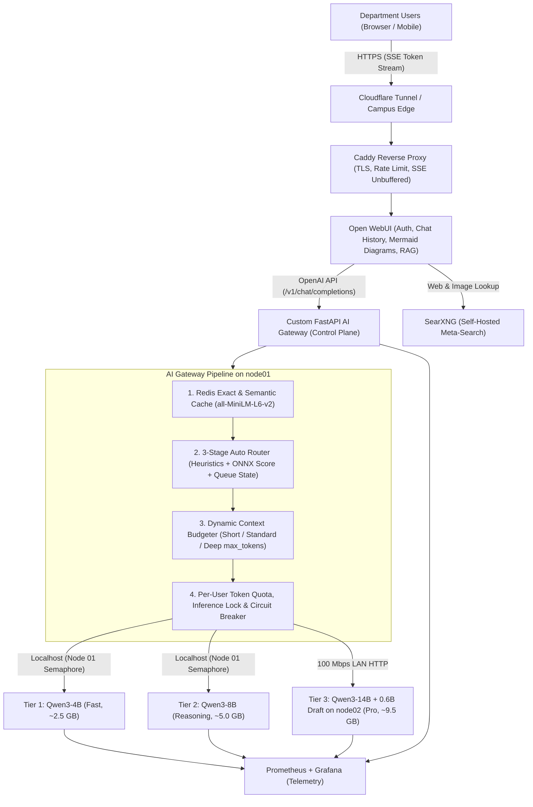
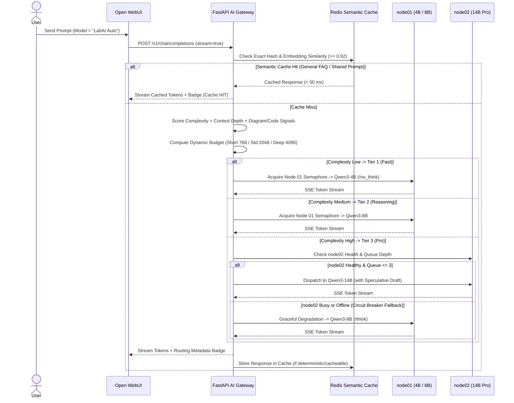
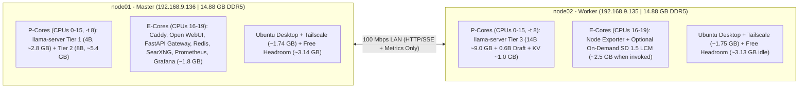

# System & Infrastructure Architecture (`LabAI`)

This document details the **system design**, **technology selection rationale**, **CPU/memory/network topology**, and **step-by-step implementation order** for deploying a production-grade, ChatGPT-like multi-user platform across two constrained university lab nodes.

---

## 1. Hardware Constraints & Bottleneck Physics

Every architectural decision in this project flows directly from measured hardware introspection on `node01` and `node02`:

| Resource | Measured Specification | Architectural Consequence |
| :--- | :--- | :--- |
| **Compute** | `2× Intel Core i7-12700` (No GPU / No CUDA) | GPU engines (`vLLM`, `SGLang`, `TGI`) cannot be used. Inference runs on CPU via `llama.cpp` (`AVX2` + `AVX-VNNI`). |
| **Core Topology** | Hybrid Alder Lake: `8` Performance cores (`16T`) + `4` Efficiency cores (`4T`), `12 MiB` L2 (`9` instances), `25 MiB` L3 | Running inference across all `20` threads causes P-cores to stall at thread barriers waiting for slower E-cores. **P-cores must be isolated for inference; E-cores run web/infra.** |
| **Memory** | `14.88 GB` DDR5-4800 (`Controller0-DIMMA1: 16 GB`, `Controller1-DIMMB1: Empty`) | **Single-channel mode** limits theoretical memory bandwidth to `38.4 GB/s` (~28–32 GB/s real-world). Token decode speed is strictly memory-bandwidth bound (`Bandwidth / Model_Size`), and `14.88 GB` caps single-node models at `~14B Q4_K_M`. |
| **Network** | `2500baseT/Full` NICs capped at `100Mb/s` by lab switch (`94.7 / 94.0 Mbps`, `0.441 ms` ping) | Distributed model splitting (`llama.cpp` RPC) suffers ~1.5–2s prefill stalls over `100 Mbps` for long prompts. **Keep each model self-contained on one node**; `100 Mbps` is plenty for HTTP/SSE text streaming (~1 Mbps for 200 users). |
| **OS & Access** | Ubuntu Desktop (`Linux 7.0.0-44-generic`) managed remotely via **Tailscale SSH** | With Ubuntu Desktop + Tailscale already running, `13.14 GB` RAM is still free (`~1.74 GB` baseline). Keep Ubuntu Desktop intact to avoid any remote lockout risk; only disable auto-sleep/suspend (`sleep.target`) so the lab machines stay awake 24/7. |

---

## 2. Technology Selection & Rationale

### 2.1 Why `Qwen3` (`4B` / `8B` / `14B`) Over Other Models?

| Model / Family | Verdict | Why / Why Not |
| :--- | :--- | :--- |
| **Qwen3 (`4B`, `8B`, `14B` Q4_K_M)** | **Selected** | Clean 3-tier sizing (`2.50 GB`, `5.03 GB`, `9.00 GB`) that fits `2× 14.88 GB` nodes 24/7; top-tier coding, math, tool calling, and Mermaid syntax; **native `/think` vs `/no_think` toggle** gives dynamic reasoning without loading a second model. |
| **GPT-2** | Rejected | 2019 base model (`124M–1.5B`, 1024-token context). Not instruction-tuned for chat, coding, or diagrams. |
| **GPT-3** | Not applicable | Proprietary closed-weight OpenAI model (cannot be self-hosted). |
| **Kimi (e.g., Kimi K2)** | Rejected | Massive MoE scale (hundreds of GBs of weights); physically impossible to fit into `29.76 GB` total cluster RAM. |
| **Llama 3.1 / 3.2** | Alternative | Strong quality, but jumps from `3B` directly to `8B` with no `4B` or `14B` tier in the same generation, leaving our `14.88 GB` Worker (`node02`) underutilized or forced into `70B` (impossible). |
| **Gemma 3 (`4B`, `12B`)** | Alternative | Very strong quality and multimodal support; viable drop-in alternative for Tiers 1 and 3, though Qwen3 edges ahead on coding/reasoning and unified 4B/8B/14B sizing. |
| **Mistral (`7B`, `Nemo 12B`, `Small 24B`)** | Rejected | `7B v0.3` is older; `Small 24B` (`~14.5 GB`) overflows a `14.88 GB` node once OS + KV cache are added. |

### 2.2 Why Native `llama.cpp` (`llama-server`) Over `Ollama`?

- **Ollama is a wrapper around `llama.cpp`.** Running `llama.cpp` (`llama-server`) directly compiled from source (`-DGGML_NATIVE=ON`) uses the exact same `GGUF` models while unlocking critical bare-metal controls:
  - Explicit P-core CPU pinning (`taskset`) per tier.
  - Quantized KV cache (`-ctk q8_0 -ctv q8_0`) to stretch `14.88 GB` RAM.
  - Prefix cache reuse (`--cache-reuse`) so shared system prompts are not recomputed.
  - Native speculative decoding (`--model-draft`) on `node02`.
  - Built-in Prometheus `/metrics` endpoint (`TTFT`, `TPOT`, slot queue depth, KV cache %).

### 2.3 Why `Open WebUI` Over Building a Custom Frontend?

Building a ChatGPT-grade frontend from scratch (auth, RBAC, streaming Markdown, LaTeX math, syntax-highlighted code blocks, chat history DB, file upload/RAG, Mermaid rendering, mobile responsiveness) takes months of boilerplate. **Open WebUI** gives all of that out-of-the-box—including **native interactive Mermaid.js diagram rendering** and **SearXNG web search integration**—while connecting cleanly to our custom OpenAI-compatible AI Gateway so our engineering effort goes into the **distributed systems & AI control plane**, not React CSS.

### 2.4 Why `systemd` + `Docker Compose` Over `Kubernetes (k8s / k3s)`?

| Option | RAM Overhead | Fit for This Cluster |
| :--- | :--- | :--- |
| **Full Kubernetes (`k8s`)** | ~1.5 – 2.5 GB/node | **Too heavy.** Eats ~15% of each node's `14.88 GB` RAM just for control plane / `kubelet` / `etcd` / CNI before serving a single token. |
| **`k3s` (Lightweight K8s)** | ~450 – 700 MB/node | Viable only if Kubernetes manifests/HPA are an explicit learning goal; adds containerization indirection over CPU pinning (`taskset`) and local model files. |
| **Bare-Metal `systemd` (`llama-server`) + `Docker Compose` (Control Plane)** | **< 50 MB** for `systemd` | **Selected.** Zero virtualization tax on memory-bandwidth-sensitive inference; clean container isolation for Gateway, Open WebUI, Redis, SearXNG, Caddy, Prometheus, and Grafana. |

---

## 3. High-Level System Architecture

---

## 4. Request Lifecycle, Auto Routing & Dynamic Budgeting

Users see four clean modes in the UI: **`LabAI Auto`** (default), **`LabAI Fast`**, **`LabAI Reasoning`**, and **`LabAI Pro`**.

### Dynamic Response Length Policy

Instead of a rigid `max_tokens = 700` cutoff that breaks mid-code, the **Dynamic Context Budgeter** adjusts both prompt steering and upper safety limits per request:

| Detected Intent | Prompt Signals | System Steering | Ceiling (`max_tokens`) | Fairness Control |
| :--- | :--- | :--- | :--- | :--- |
| **Quick / Factual** | Short prompt (`< 25` tokens), no code/files | *"Be concise and direct."* | `768` | Per-user sliding window (`8,000` output tokens / 15 min) + max `1` active stream/user |
| **Standard Chat** | Multi-turn explanation, general Q&A | Balanced | `2048` | Same sliding token bucket |
| **Deep / Coding / Architecture** | Code blocks, stack traces, `"debug"`, `"implement"`, `"step by step"`, RAG docs | *"Provide complete, un-omitted code/analysis."* | `4096` | Same sliding token bucket |

---

## 5. Infrastructure, CPU Core Isolation & Memory Budget

On the `i7-12700` (`20` logical CPUs), Linux typically maps the `8` HyperThreaded P-cores to CPUs `0–15` and the `4` E-cores to CPUs `16–19` *(verify exact topology with `lscpu -e` before pinning)*.

### Memory Allocation Summary

Based on the measured `13.14 GB` available RAM with Ubuntu Desktop + Tailscale already running (`~1.74 GB` OS baseline):

| Node | Component | RAM Budget | Notes |
| :--- | :--- | :--- | :--- |
| **`node01`** | Ubuntu Desktop + Tailscale + `systemd` | `~1.74 GB` | Measured baseline (`14.88 - 13.14 GB`); GUI left intact for safe remote ops |
| **`node01`** | Docker Infra (`Open WebUI`, `Gateway`, `Redis`, `SearXNG`, `Caddy`, `Prom/Grafana`) | `~1.80 GB` | Pinned to E-cores (`cpuset: "16-19"`) |
| **`node01`** | `Qwen3-4B` (`Q4_K_M`) + KV (`q8_0`) | `~2.80 GB` | Always hot in RAM |
| **`node01`** | `Qwen3-8B` (`Q4_K_M`) + KV (`q8_0`) | `~5.40 GB` | Always hot in RAM; serialized via Gateway semaphore |
| **`node01`** | **Free Headroom / Page Cache** | **`~3.14 GB`** | Zero swap thrashing |
| **`node02`** | Ubuntu Desktop + Tailscale + `Node Exporter` | `~1.75 GB` | Pure compute worker managed over Tailscale SSH |
| **`node02`** | `Qwen3-14B` (`Q4_K_M`) + `Qwen3-0.6B` Draft + KV (`q8_0`) | `~10.00 GB` | Dedicated to Node 02 P-cores |
| **`node02`** | **Free Headroom** | **`~3.13 GB`** | Safely absorbs long-context KV caches or on-demand `SD 1.5 LCM` |

---

## 6. Phased Implementation Roadmap ("What After What")

All deployment and administration happens remotely over **Tailscale SSH** from home, so every step avoids risky network/display-manager changes that could drop remote connectivity:

1. **Phase 0 — Remote-Safe OS & Hardware Prep (Both Nodes via Tailscale SSH)**
   * Verify exact P-core/E-core CPU IDs (`lscpu -e`) and keep existing LAN IPs (`192.168.9.136`, `192.168.9.135`) + Tailscale IPs untouched.
   * Keep Ubuntu Desktop intact (`13.14 GB` free RAM is plenty); mask sleep/suspend targets (`sudo systemctl mask sleep.target suspend.target hibernate.target hybrid-sleep.target`) so GNOME never puts the lab PCs to sleep.
   * Tune `vm.swappiness=1` so model weights stay pinned in RAM instead of swapping.
2. **Phase 1 — Bare-Metal Inference Engines (`node01` & `node02`)**
   * Compile `llama.cpp` natively on each machine (`cmake -B build -DGGML_NATIVE=ON`).
   * Download `Qwen3-4B`, `Qwen3-8B`, and `Qwen3-14B` (`Q4_K_M` GGUFs) + `Qwen3-0.6B` draft model.
   * Configure `systemd` units with `CPUAffinity` (P-cores only), `-np 1` / `-np 2`, `-ctk q8_0 -ctv q8_0`, `--cache-reuse`, and `--metrics`. Benchmark single-node TTFT and `tok/s` baseline before adding any proxy.
3. **Phase 2 — Intelligent AI Gateway (`node01`)**
   * Build the FastAPI service implementing `/v1/models` and `/v1/chat/completions` (streaming SSE).
   * Add: (a) Redis exact + ONNX semantic cache, (b) 3-stage Auto Router + live queue inspection, (c) dynamic context-aware `max_tokens` + `/think` steering, (d) Node 01 inference semaphore, and (e) Node 02 circuit breaker + failover.
4. **Phase 3 — Chat Experience, Search & Visuals (`node01`)**
   * Deploy `docker-compose.yml` (pinned to E-cores) with **Open WebUI**, **Redis**, **SearXNG**, and **Caddy** (with `flush_interval -1` for zero-buffer SSE streaming).
   * Wire Open WebUI to the Gateway's OpenAI endpoint, enable SearXNG web/image search, and configure Mermaid diagram formatting rules.
   * *(Optional)* Add local `stable-diffusion.cpp` (`SD 1.5 LCM`) on `node02` or plug an external `/images/generations` provider into the Gateway.
5. **Phase 4 — Observability & Secure Access (`node01` & `node02`)**
   * Deploy `node_exporter` on both nodes + `Prometheus` & `Grafana` on `node01` scraping Gateway + both `llama-server` `/metrics` endpoints.
   * Expose Open WebUI externally via **Cloudflare Tunnel** (`cloudflared`) with `@university.edu` signup restrictions / invite codes.
6. **Phase 5 — Load Testing & Hardening**
   * Run async load tests (`1` → `20` → `100` simulated department requests) to calibrate queue limits, cache similarity thresholds (`~0.92`), and token-bucket rate limits.
